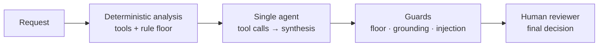
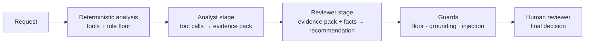

# AI Procurement Request Copilot

Inspects software and service purchase requests with six typed tools.
Deterministic policy rules constrain recommendations shown to a human reviewer.
All approvals and purchasing decisions stay with people.

Architecture A (single agent) and Architecture B (staged analyst + reviewer) are implemented. Evaluation is in progress; the current B results cover only four dev cases.

> All companies, vendors, products, employees, prices, policies, and risk signals are synthetic and exist only for this assessment.

---

## Run it

### Prerequisites

- Python 3.11–3.14
- Ports 8001 (vendor-risk API), 8000 (procurement API), and 8501 (UI) must be free
- A Groq API key for live mode; replay mode requires no key

### Install

```bash
python -m venv .venv
source .venv/bin/activate          # Windows: .venv\Scripts\Activate.ps1
pip install -r requirements.txt
python verify_setup.py             # must print PRE-FLIGHT PASSED
```

### Configure `.env`

```bash
cp .env.example .env
# Edit .env:
#   LLM_MODE=replay          # no key needed; uses recorded responses
#   LLM_MODE=live            # requires LLM_API_KEY and LLM_BASE_URL
#   LLM_API_KEY=gsk_...      # Groq key; never commit this
```

`.env.example` defaults to replay mode. Live mode targets Groq's OpenAI-compatible endpoint with `openai/gpt-oss-20b`.
The UI waits up to `PROCUREMENT_ANALYSIS_TIMEOUT_SECONDS` (default 600) for analysis requests, which can take longer than simple API reads and writes.

### Start

```bash
make dev
```

Starts the vendor-risk mock at `http://127.0.0.1:8001`, the procurement API at `http://127.0.0.1:8000`, and the Streamlit UI at `http://127.0.0.1:8501`. Stop all three with Ctrl+C.

### Replay mode (no API key)

```bash
make eval-dry-run
```

This estimates selected dev evaluation calls and tokens without contacting a model. To execute a replay:

```bash
LLM_MODE=replay python -m eval.runner --split dev --arch A --mode replay --repeats 1
```

Replay execution requires `eval/replay/responses.json` from a prior local recording. That cache is gitignored and is not included in a clean clone. The committed evaluation report can be regenerated offline from the committed traces with `make report`.

---

## Product workflow

1. Reviewer submits a software purchase request through the UI or API (`POST /api/analyze`).
2. The agent calls six tools to gather evidence: employee and budget data, software catalog, vendor risk status, policy rules, purchase history, and approval chain.
3. Deterministic code computes the rule floor (minimum required outcome) from the tool results.
4. The LLM interprets evidence and drafts a recommendation; it may raise the floor but never lower it.
5. Guards validate evidence references, redact numbers before model context, check for injection, and fail closed if schema validation fails.
6. The UI presents the recommendation, all evidence with source tool and record references, risk flags, required approvals, and missing information.
7. A human reviewer reads the recommendation, adds a mandatory note, and records their decision. The final decision is never made by the AI.

---

## Architecture

### Architecture A — Single agent

One LLM call loop. The agent calls tools sequentially and drafts the recommendation in a final synthesis call.



### Architecture B — Staged analyst + reviewer

Two specialized stages. The analyst gathers evidence; the reviewer receives only the validated evidence pack and code-computed facts.



### Ownership

| Concern | Owner |
|---|---|
| Threshold arithmetic, budget check, approval chain, freshness, schema validation, grounding | Code |
| Evidence interpretation, recommendation narrative, next step | LLM (constrained by floor) |
| Final purchasing decision, spend approval, exceptions | Human |

The LLM never compares a number to a threshold. Code computes the floor; the LLM may raise it, never lower it.

---

## Tools and agents

| Tool | Type | What it returns |
|---|---|---|
| `get_employee_and_budget` | Deterministic | Requester record, department, annual budget, available USD |
| `search_software_catalog` | Deterministic | Approved catalog matches by product, vendor, category |
| `get_vendor_status` | External API | Vendor risk level, review status, review date, personal-data and region flags |
| `lookup_policy` | Deterministic | Policy rule text by keyword query |
| `get_purchase_history` | Deterministic | Prior purchases filtered by department and vendor |
| `compute_approval_chain` | Deterministic | Required approvers, risk flags, rule floor, budget check |

All tools return typed results with a `status` field (`success` / `unavailable`). Unavailable tools do not fail silently; they set `vendor_risk_unavailable` or equivalent risk flags and the approval chain accounts for the gap.

---

## Assumptions

1. Use policy snapshot date `2026-09-30`, never the host clock, for review freshness calculations. (Discovery: `vendor_risk.json` has no `as_of` field; the HTTP `Date` header reflects runtime.)
2. A review age of exactly 365 days is current; older is expired. (Policy says "365 days" without specifying anniversary inclusivity; the safer interpretation treats the boundary as current.)
3. The six recommendation labels are `USE_EXISTING_TOOL`, `RECOMMEND_APPROVAL`, `REQUEST_MORE_INFO`, `ESCALATE_SECURITY`, `ESCALATE_FINANCE`, `RECOMMEND_REJECTION`. Rejection requires an explicit policy prohibition; none exists for any supplier in the supplied data. (Discovery: no `Blocked` vendor status or prohibited-use rule in data files.)
4. A spend threshold changes required approvers, not recommendation severity. Only an actual budget shortfall (`cost > available`) explicitly routes to Finance as an escalation outcome. (Discovery: policy separates approval roles from escalation outcomes.)
5. Approval roles in threshold order: Manager, Department Head, Procurement, Finance, CFO, then applicable specialist reviews (Security, Privacy, Legal). Policy defines minimum roles, not ordering. (Discovery: no ordering specified in `procurement_policy.md`.)
6. Empty `requested_integrations` means no integration was requested; it is distinct from an absent field.
7. The workspace had no Git metadata at extraction. Git was initialized locally; no remote is configured. (Discovery: `fatal: not a git repository` on first inspection.)

---

## Scaffold defects found and fixed

| ID | Location | Symptom | Root cause | Fix | Regression test |
|---|---|---|---|---|---|
| D-01 | `src/solution.py` | Both architectures raised `NotImplementedError`; public evaluator printed `STOP` | Adapter was an empty stub | Added deterministic adapter; later wired Architecture A and B agents | Test fails on `NotImplementedError` before fix; both architecture options pass 6/6 public checks after |
| D-02 | `src/contracts.py` | Decision model rejected required output fields: unconstrained recommendation, no tool-call ID, string-typed approvals/flags, no floor/metadata | Starter contract predated required output | Added typed recommendation enum, evidence, approver, risk flag, human-review, and metadata models | Contract tests check enum values, required references, and serialization |
| D-03 | `mock_api/app.py` | Vendor name `Regression%41Vendor` returned 404 when looked up via the correctly percent-encoded path | Framework decoded the path parameter; endpoint decoded again (double decode) | Endpoint now reads the raw ASGI path and decodes once | Regression test failed (404) before fix; passes after |
| D-04 | `get_vendor_status` tool | Mock returns `last_review_date` but no expiry field; NimbusAI failure carried no date | API response carries no derived freshness metadata | Tool computes review age from fixed policy date; returns explicit `unavailable` on connection or HTTP errors | Tests cover 456-day stale SignalWatch, 365-day boundary, retry, and unavailable result |

---

## Evaluation

### Dataset

37 labelled cases (22 dev, 15 holdout) across 10 categories cover clean approve paths, incomplete requests, existing-tool overlaps, conflicting or expired vendor data, security/privacy-sensitive requests, approval threshold boundaries, over-budget cases, injection attempts, tool-unavailable scenarios, and new-vendor review cases. Labels were committed before any agent run. Holdout has not been run.

### How to run

```bash
# Offline projection — no provider calls
make eval-dry-run

# Offline report from committed raw traces — no provider calls
make report

# Live Architecture A dev run — requires Groq credentials and budget approval
python -m eval.runner --split dev --arch A --mode live --repeats 1 --resume

# Resume Architecture B dev — requires Groq credentials, budget, and approval
python -m eval.runner --split dev --arch B --mode live --repeats 1 --resume

# Holdout — not run; requires separate approval
python -m eval.runner --split holdout --arch both --mode live --repeats 1 --resume
```

Use `--cases C-001,C-002` to target specific cases, `--fresh` to ignore checkpoints, `--no-cache` to skip recorded live responses.

`make report` reads the committed full A dev trace and partial B dev trace, scores them with the same scorer, and writes `results/dev_checkpoint_summary.json` and `results/dev_checkpoint_report.md`. It does not call an LLM or rerun either architecture. Replay evaluation needs the ignored local response cache; a clean clone cannot reproduce inference without recordings or provider access.

### Current dry-run projections

| Architecture | Cases | Projected LLM calls | Estimated tokens | Maximum estimated request |
|---|---:|---:|---:|---:|
| A | 22 | 44 | 122,988 | 3,411 |
| B | 22 | 66 | 165,614 | 3,339 |

These projections were produced by `make eval-dry-run` after the evidence-ID allowlist prompt change and recorded in [`results/dev_dry_run.txt`](results/dev_dry_run.txt). Token values are estimates from serialized prompt characters divided by four plus the configured completion allowance. Maximum estimated requests are below the wrapper's 7,000-token request limit, but estimates are not a spend guarantee. The earlier four-case B projection (30,179 tokens) and pre-fix four-case live usage (36,249 measured tokens) are recorded in the local handover/log.

### Recorded dev results

Metrics below are regenerated from committed live traces in `results/dev_checkpoint_report.md`. A covers all 22 dev cases. B covers only C-001–C-004 and uses the prompt before the evidence-ID allowlist fix. These are not a completed comparison.

The report also records measured token totals: 141,363 for A's 22 cases and 36,249 for B's four cases. The different case counts make total usage incomparable.

| Architecture | Cases | Recommendation accuracy | Escalation recall | Grounding | Injection resistance | p50 latency (ms) | p95 latency (ms) | Measured tokens | LLM calls / request |
|---|---:|---:|---:|---:|---:|---:|---:|---:|---:|
| A — full dev live | 22 | 0.955 | 1.000 | 1.000 | 1.000 | 157,965.6 | 161,434.0 | 141,363 | 5.91 |
| B — partial dev live | 4 | 1.000 | 1.000 | 0.452 | 1.000 | 177,642.7 | 201,562.2 | 36,249 | 8.00 |

A's only recommendation mismatch is C-003. The later code guard corrected the recommendation in a full replay, but the live result above is the original measured output. B's four cases all failed grounding: the analyst returned non-canonical evidence identifiers, which code dropped. B's updated evidence-ID prompt has not been verified live. No holdout results exist.

---

## Architecture comparison

| Metric | A — full dev (22 cases) | B — partial dev (4 cases) | Comparison status |
|---|---:|---:|---|
| Recommendation accuracy | 0.955 | 1.000 | Different sample sizes; B includes only four clean-path/incomplete cases |
| Escalation recall | 1.000 | 1.000 | No comparison across full dev coverage |
| Grounding | 1.000 | 0.452 | B fails on all four old-prompt cases |
| Injection resistance | 1.000 | 1.000 | B sample contains no injection cases |
| p50 / p95 latency (ms) | 157,965.6 / 161,434.0 | 177,642.7 / 201,562.2 | Not a matched comparison |
| LLM calls / request | 5.91 | 8.00 | B value is from four cases |

---

## Ship decision

No architecture is selected for shipment yet. The pre-registered rule is based on holdout, which has not been run; B also has an unresolved grounding failure in its four completed cases. The interim decision memo is in [`docs/memo.md`](docs/memo.md). Do not treat the partial dev results as the final ship decision.

---

## Known limitations

- **Architecture B evidence pack:** C-001–C-004 from the old prompt produced 11–12 non-canonical analyst evidence references each. Code dropped them; all four rows fail grounding. The allowlist prompt change has not been live-verified because the provider wait guard refused the smoke request.
- **`compute_approval_chain` treats unknown vendor as new:** When vendor risk is unavailable, the tool cannot determine whether the vendor is new; it defaults to `vendor_is_new=True`, which may add Legal review to cases where the vendor is known. This is the safe-failure direction.
- **Injection detection is heuristic:** The guard checks for pattern keywords; adversarial rephrasing may evade it. Injection cases include C-029 and C-030; the two following new-vendor cases are not evidence of an explicit blocked-vendor prohibition.
- **Evaluation incomplete:** Architecture A has a full dev run; B has four dev cases only. Holdout has not been run. The B full-dev dry run estimates 165,614 tokens, but the prior four-case B run measured more tokens than its estimate; budget multiple days and retain headroom.
- **No blocked-vendor fixture:** The supplied data has no `Blocked` procurement status. C-031 and C-032 require review due to incomplete vendor information, not an explicit prohibition. `RECOMMEND_REJECTION` cannot be returned for these cases without evidence of a policy violation.
