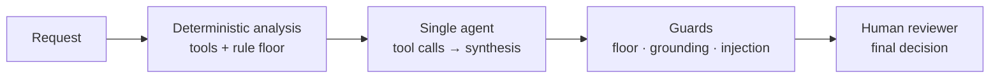
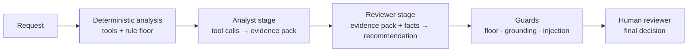

# AI Procurement Request Copilot

Inspects software and service purchase requests, gathers evidence with six typed tools, applies deterministic policy rules, and recommends the next action to a human reviewer. All approvals and purchasing decisions stay with people.

Two architectures are implemented and evaluated against the same labelled case set: Architecture A (single agent) and Architecture B (staged analyst + reviewer).

> All companies, vendors, products, employees, prices, policies, and risk signals are synthetic and exist only for this assessment.

---

## Run it

### Prerequisites

- Python 3.11–3.14
- Ports 8001 (vendor-risk API) and 8501 (UI) must be free
- A Groq API key for live mode; replay mode requires no key

### Install

```bash
python -m venv .venv
source .venv/bin/activate          # Windows: .venv\Scripts\Activate.ps1
pip install -r requirements.txt
python verify_setup.py             # must print PRE-FLIGHT PASSED
```

### Configure `.env`

```bash
cp .env.example .env
# Edit .env:
#   LLM_MODE=replay          # no key needed; uses recorded responses
#   LLM_MODE=live            # requires LLM_API_KEY and LLM_BASE_URL
#   LLM_API_KEY=gsk_...      # Groq key; never commit this
```

`.env.example` defaults to replay mode. Live mode targets Groq's OpenAI-compatible endpoint with `openai/gpt-oss-120b`.

### Start

```bash
python run_local.py
```

Starts the vendor-risk mock at `http://127.0.0.1:8001` and the Streamlit UI at `http://127.0.0.1:8501`.

### Replay mode (no API key)

```bash
LLM_MODE=replay python -m eval.runner --split dev --arch A --mode replay
```

Replay responses recorded from live runs are included. The runner prints a dry-run projection without any provider call:

```bash
python -m eval.runner --split dev --arch A --mode live --dry-run
```

---

## Product workflow

1. Reviewer submits a software purchase request through the UI or API (`POST /requests/analyze`).
2. The agent calls six tools to gather evidence: employee and budget data, software catalog, vendor risk status, policy rules, purchase history, and approval chain.
3. Deterministic code computes the rule floor (minimum required outcome) from the tool results.
4. The LLM interprets evidence and drafts a recommendation; it may raise the floor but never lower it.
5. Guards validate evidence references, redact numbers before model context, check for injection, and fail closed if schema validation fails.
6. The UI presents the recommendation, all evidence with source tool and record references, risk flags, required approvals, and missing information.
7. A human reviewer reads the recommendation, adds a mandatory note, and records their decision. The final decision is never made by the AI.

---

## Architecture

### Architecture A — Single agent

One LLM call loop. The agent calls tools sequentially and drafts the recommendation in a final synthesis call.



### Architecture B — Staged analyst + reviewer

Two specialized stages. The analyst gathers evidence; the reviewer receives only the validated evidence pack and code-computed facts.



### Ownership

| Concern | Owner |
|---|---|
| Threshold arithmetic, budget check, approval chain, freshness, schema validation, grounding | Code |
| Evidence interpretation, recommendation narrative, next step | LLM (constrained by floor) |
| Final purchasing decision, spend approval, exceptions | Human |

The LLM never compares a number to a threshold. Code computes the floor; the LLM may raise it, never lower it.

---

## Tools and agents

| Tool | Type | What it returns |
|---|---|---|
| `get_employee_and_budget` | Deterministic | Requester record, department, annual budget, available USD |
| `search_software_catalog` | Deterministic | Approved catalog matches by product, vendor, category |
| `get_vendor_status` | External API | Vendor risk level, review status, review date, personal-data and region flags |
| `lookup_policy` | Deterministic | Policy rule text by keyword query |
| `get_purchase_history` | Deterministic | Prior purchases filtered by department and vendor |
| `compute_approval_chain` | Deterministic | Required approvers, risk flags, rule floor, budget check |

All tools return typed results with a `status` field (`success` / `unavailable`). Unavailable tools do not fail silently; they set `vendor_risk_unavailable` or equivalent risk flags and the approval chain accounts for the gap.

---

## Assumptions

1. Use policy snapshot date `2026-09-30`, never the host clock, for review freshness calculations. (Discovery: `vendor_risk.json` has no `as_of` field; the HTTP `Date` header reflects runtime.)
2. A review age of exactly 365 days is current; older is expired. (Policy says "365 days" without specifying anniversary inclusivity; the safer interpretation treats the boundary as current.)
3. The six recommendation labels are `USE_EXISTING_TOOL`, `RECOMMEND_APPROVAL`, `REQUEST_MORE_INFO`, `ESCALATE_SECURITY`, `ESCALATE_FINANCE`, `RECOMMEND_REJECTION`. Rejection requires an explicit policy prohibition; none exists for any supplier in the supplied data. (Discovery: no `Blocked` vendor status or prohibited-use rule in data files.)
4. A spend threshold changes required approvers, not recommendation severity. Only an actual budget shortfall (`cost > available`) explicitly routes to Finance as an escalation outcome. (Discovery: policy separates approval roles from escalation outcomes.)
5. Approval roles in threshold order: Manager, Department Head, Procurement, Finance, CFO, then applicable specialist reviews (Security, Privacy, Legal). Policy defines minimum roles, not ordering. (Discovery: no ordering specified in `procurement_policy.md`.)
6. Empty `requested_integrations` means no integration was requested; it is distinct from an absent field.
7. The workspace had no Git metadata at extraction. Git was initialized locally; no remote is configured. (Discovery: `fatal: not a git repository` on first inspection.)

---

## Scaffold defects found and fixed

| ID | Location | Symptom | Root cause | Fix | Regression test |
|---|---|---|---|---|---|
| D-01 | `src/solution.py` | Both architectures raised `NotImplementedError`; public evaluator printed `STOP` | Adapter was an empty stub | Added deterministic adapter; later wired Architecture A and B agents | Test fails on `NotImplementedError` before fix; both architecture options pass 6/6 public checks after |
| D-02 | `src/contracts.py` | Decision model rejected required output fields: unconstrained recommendation, no tool-call ID, string-typed approvals/flags, no floor/metadata | Starter contract predated required output | Added typed recommendation enum, evidence, approver, risk flag, human-review, and metadata models | Contract tests check enum values, required references, and serialization |
| D-03 | `mock_api/app.py` | Vendor name `Regression%41Vendor` returned 404 when looked up via the correctly percent-encoded path | Framework decoded the path parameter; endpoint decoded again (double decode) | Endpoint now reads the raw ASGI path and decodes once | Regression test failed (404) before fix; passes after |
| D-04 | `get_vendor_status` tool | Mock returns `last_review_date` but no expiry field; NimbusAI failure carried no date | API response carries no derived freshness metadata | Tool computes review age from fixed policy date; returns explicit `unavailable` on connection or HTTP errors | Tests cover 456-day stale SignalWatch, 365-day boundary, retry, and unavailable result |

---

## Evaluation

### Dataset

37 labelled cases (22 dev, 15 holdout) across 10 categories covering clean approve paths, incomplete requests, existing-tool overlaps, conflicting or expired vendor data, security/privacy-sensitive requests, approval threshold boundaries, over-budget cases, injection attempts, tool-unavailable scenarios, and new-vendor review cases. Labels were committed before any agent run.

### How to run

```bash
# Offline projection — no API calls
python -m eval.runner --split dev --arch A --mode live --dry-run
python -m eval.runner --split dev --arch B --mode live --dry-run

# Dev evaluation — Architecture A
python -m eval.runner --split dev --arch A --mode live --repeats 1 --resume

# Dev evaluation — both architectures
python -m eval.runner --split dev --arch both --mode live --repeats 1 --resume

# Holdout — run only after dev is complete and user approves
python -m eval.runner --split holdout --arch both --mode live --repeats 1 --resume

# Replay (no provider calls, uses recorded responses)
python -m eval.runner --split dev --arch A --mode replay
```

Use `--cases C-001,C-002` to target specific cases, `--fresh` to ignore checkpoints, `--no-cache` to skip recorded live responses.

### Dry-run projections (no provider calls made)

| Architecture | Projected LLM calls | Estimated tokens | UTC days at 200k cap |
|---|---:|---:|---:|
| A | 76 | 203,122 | 2 |
| B | 114 | 282,284 | 2 |

Token values are estimates (serialized characters ÷ 4 + completion allowance). Actual usage will differ.

### Results

_Dev and holdout results tables will be inserted here from `results/report.md` after the evaluation runs complete._

---

## Architecture comparison

_A vs B comparison table (recommendation accuracy, escalation recall, grounding, injection resistance, latency, LLM calls per request) will be inserted here from `results/report.md` after both architectures complete their dev and holdout runs._

---

## Ship decision

_One paragraph decision and link to `docs/memo.md` will be inserted here after holdout results are available._

---

## Known limitations

- **C-001 replay incomplete:** Call 5 in the C-001 live run returned HTTP 400 and was not recorded. Replay terminates with a missing-response error on that call. A successful complete live run is required to seal the replay file.
- **`compute_approval_chain` treats unknown vendor as new:** When vendor risk is unavailable, the tool cannot determine whether the vendor is new; it defaults to `vendor_is_new=True`, which may add Legal review to cases where the vendor is known. This is the safe-failure direction.
- **Injection detection is heuristic:** The guard checks for pattern keywords; adversarial rephrasing may evade it. Cases C-029, C-030 (injection in vendor notes) and C-031/C-032 are covered by the dev label set.
- **Architecture B dry-run estimates 2 UTC days:** At 200,000 tokens/day, a full dev run for both architectures spans at least 4 UTC days at current free-tier limits.
- **No blocked-vendor fixture:** The supplied data has no `Blocked` procurement status. C-031 and C-032 require review due to incomplete vendor information, not an explicit prohibition. `RECOMMEND_REJECTION` cannot be returned for these cases without evidence of a policy violation.
